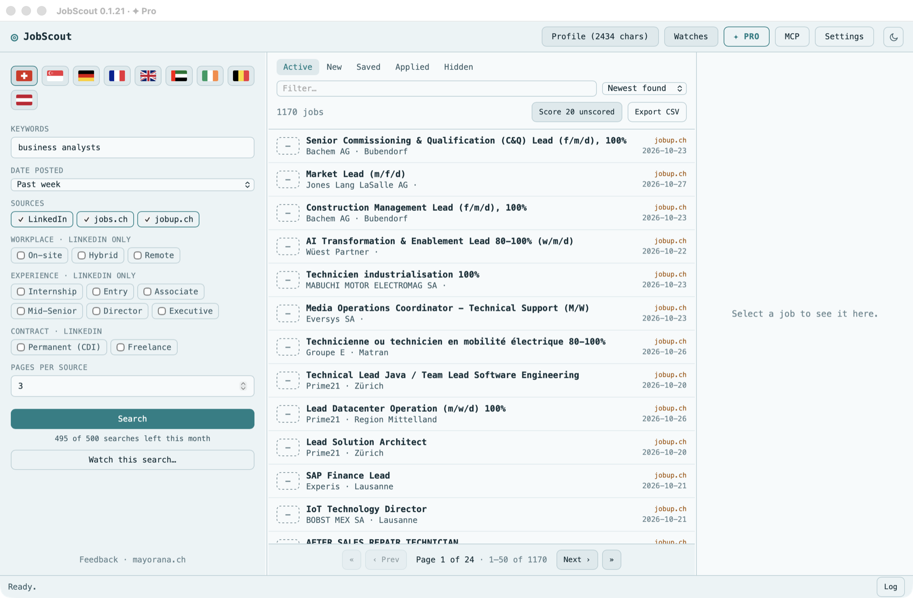

# JobScout



A desktop app (Rust + Dioxus) that collects job posts and ranks them against
your profile, for one country at a time: Switzerland (LinkedIn, jobs.ch,
jobup.ch), Singapore (LinkedIn, MyCareersFuture, JobStreet), Germany
(LinkedIn, Arbeitsagentur, StepStone), France (LinkedIn, France Travail), the
United Kingdom (LinkedIn, Totaljobs, Reed), the United Arab Emirates
(LinkedIn, Bayt), Ireland (LinkedIn, IrishJobs), Belgium (LinkedIn,
stepstone.be) or Austria (LinkedIn, stepstone.at).

- **Search** LinkedIn's public guest endpoints. No login is used, so no account is at risk. You can filter by keywords, location, date posted, workplace type and experience level, and choose how many pages to fetch.
- **Keep** every job found in `~/Library/Application Support/JobScout/<country>/jobs.json`, deduplicated by job id. Each job has a status (New / Saved / Applied / Hidden).
- **Read** the full description and criteria inside the app. A job's description is fetched when you first open it.
- **Score** jobs against your profile with any OpenAI-compatible model (api0 in Europe, China or the United States by default, paid for by your licence's AI credits; or a local ollama). Each score comes with a one-line verdict, strengths and gaps.
- **Export** the visible list to CSV.

## Install

Signed builds for macOS (Apple Silicon and Intel), Windows and Linux are on
[JobScout's page](https://mayorana.ch/en/apps/jobscout):

- **macOS**: open `jobscout-macos.dmg` and drag JobScout to Applications.
- **Windows**: run `jobscout-setup.exe`. It needs the Microsoft Edge WebView2
  Runtime, which Windows 11 and up-to-date Windows 10 already have.
- **Linux**: extract `jobscout-linux-x86_64.tar.gz`, then run
  `sudo ./setup-linux.sh` once for the libraries and the launcher.

JobStreet (Singapore) also needs Camoufox: `pip install -U camoufox && python -m camoufox fetch`.

JobScout checks mayorana.ch for a newer version shortly after it starts. Set
`DISABLE_UPDATE_CHECK=1` to turn that off.

## Use from Claude (MCP)

`jobscout mcp` serves JobScout's jobs to an MCP client over stdio, with no
window (`src/mcp.rs`). The **MCP** button in the sidebar shows the Claude
Desktop config and the Claude Code command, pointing at the installed
executable. The tools: `overview`, `list_jobs`, `get_job`, `search`,
`score_jobs`, `set_status`, `get_profile`, `set_profile`, `list_watches`,
`add_watch`, `update_watch`, `delete_watch` and `export_csv`. Each takes an
optional `country` and defaults to the one open in the window.

The server and the window share the same files. The server reads, changes
and writes a file in one go, and the window reloads any file another process
changed (checked every 2 s). Watches still run only in the window. The
built-in WebKit backend needs the window's main thread, so through MCP
LinkedIn is read over plain HTTP, and JobStreet, Bayt, IrishJobs,
stepstone.at, and the job pages of stepstone.de, stepstone.be and Totaljobs,
only work with Camoufox.

## Releasing

`./scripts/release.sh` bumps the version, stamps `CHANGELOG.md`, tags and
pushes; the Release workflow then builds, signs and publishes to mayorana.ch.
`./scripts/setup-github.sh` sets the secrets it needs, once.

## Licence

Source-available under the [PolyForm Noncommercial License 1.0.0](LICENSE):
free for personal use. Commercial use requires a licence, which is
[JobScout Pro](https://mayorana.ch/en/apps/jobscout). The name and icon are
covered by [TRADEMARK.md](TRADEMARK.md).

Every plan covers every country and any number of watches. What a plan sets is
how many searches JobScout runs a month, counted on the computer across every
country (`searches.json` in the data folder): 10 for the free version, 50 on
Basic, 500 on Pro and 1000 on Max. A search from the sidebar or from Claude
counts as one, and a watch's run only when it finds new jobs; the count starts
again on the 1st.

## Run

```sh
cargo run            # or: dx serve
cargo test           # parsers, including real saved LinkedIn pages
```

Scoring uses api0 by default, which needs no key: it takes the licence number
saved in the Pro window (or `API0_API_KEY`, when set). For another model,
export the key named in Settings. The key is read from the environment and
never written to disk.

France Travail (France) needs your own free API application: register one at
[francetravail.io](https://francetravail.io), subscribe it to "Offres d'emploi
v2", put its client id in Settings and export its secret as
`FRANCE_TRAVAIL_CLIENT_SECRET` (or the variable named in Settings). The secret
is read like the scoring key and never written to disk. The live test needs
both: `FRANCE_TRAVAIL_CLIENT_ID=… FRANCE_TRAVAIL_CLIENT_SECRET=… cargo test
live_francetravail -- --ignored`.

Reed (United Kingdom) needs a free API key from
[reed.co.uk/developers](https://www.reed.co.uk/developers): export it as
`REED_API_KEY` (or the variable named in Settings). Its live test:
`REED_API_KEY=… cargo test live_reed -- --ignored`.

## Countries

The flags at the top of the sidebar pick the country. Each country is its own
context, kept in its own folder of the data directory (`ch/`, `sg/`): jobs,
watches, profile and last search. Switching unloads one and loads the other,
so nothing found in Switzerland shows up in Singapore, or the other way
round. Settings (model, backend, pacing) are shared. Switching is disabled
while a search, scoring run or watch is running. Only the loaded country's
watches run.

Data from before countries existed was all Swiss. On first start it moves
into `ch/`, and a file already in `ch/` is never overwritten.

## Sources

| Country | Source | Read from | Search filters |
|---|---|---|---|
| All | LinkedIn | Public guest endpoints (`/jobs-guest/...`), no login | All filters |
| 🇨🇭 | jobs.ch, jobup.ch | Public search and job pages, via their schema.org `JobPosting` JSON-LD. Not `/api/`, which their robots.txt disallows | Keywords, location, date posted (filtered in the app). Workplace and experience don't apply |
| 🇸🇬 | MyCareersFuture | The public JSON API its site uses (`api.mycareersfuture.gov.sg/v2`), always over plain HTTP | Keywords, date posted (filtered in the app). All of Singapore. Workplace and experience don't apply |
| 🇸🇬 | JobStreet | Public search (`/jobs?keywords=…`, the only query strings its robots.txt allows) and job pages, via the `SEEK_REDUX_DATA` state they embed. Always in a browser: the site sits behind a Cloudflare challenge that plain HTTP never passes. The built-in WebKit one, or Camoufox when that is the backend | Keywords, location (a region; "Singapore" means all), date posted. Workplace and experience don't apply |
| 🇩🇪 | Arbeitsagentur | The Jobbörse's public JSON API (`rest.arbeitsagentur.de/jobboerse/jobsuche-service`, v6 search, v4 job details), with the public `X-API-Key` every client sends. Always over plain HTTP | Keywords, date posted. All of Germany. Workplace and experience don't apply |
| 🇩🇪 | StepStone | Public search (`/jobs/{keywords}?q=…`, the only query strings its robots.txt allows under `/jobs/`) via the `__PRELOADED_STATE__` it embeds, and job pages via their schema.org `JobPosting` JSON-LD. Search over plain HTTP; job pages always in a browser, since Akamai resets plain connections to them | Keywords, date posted (last day or week on the site, a month in the app). All of Germany. Workplace and experience don't apply |
| 🇫🇷 | France Travail | The official "Offres d'emploi v2" API (`api.francetravail.io`), with an OAuth token from your own application's client id and secret. Not the site's search, which its robots.txt disallows (`motsCles=`). Always over plain HTTP. A search result is the whole posting, so descriptions come with the search | Keywords, date posted (on the API's side). All of France. Workplace and experience don't apply |
| 🇬🇧 | Totaljobs | The StepStone platform, read like StepStone: public search via `__PRELOADED_STATE__`, job pages via JSON-LD in a browser. Its robots.txt allows `/jobs/{keywords}?q=…` with nothing after `q` (`/jobs/*?q=*&` is disallowed), so only the first page, 25 postings, and no filter on the site | Keywords, date posted (filtered in the app). All of the UK. Workplace and experience don't apply |
| 🇬🇧 | Reed | The official jobseeker API (`reed.co.uk/api/1.0`), with your own key as the Basic auth user name. Not the site, whose robots.txt disallows `/jobs/`. Always over plain HTTP, 100 postings a page | Keywords, date posted (filtered in the app). All of the UK. Workplace and experience don't apply |
| 🇦🇪 | Bayt | Public search (`/en/uae/jobs/{keywords}-jobs/?page=N`; its robots.txt disallows only the country-less `/en/jobs/…-jobs/`) read from the job cards, and job pages via their schema.org `JobPosting` JSON-LD. Always in a browser: the site sits behind a Cloudflare challenge. GulfTalent was left out: its keyword search exists only in the page's JavaScript | Keywords, date posted (filtered in the app). All of the UAE. Workplace and experience don't apply |
| 🇮🇪 | IrishJobs | The StepStone platform, read like StepStone: search via `__PRELOADED_STATE__` (`/jobs/{keywords}?q=…&postedWithin=N&page=N`; its robots.txt allows `?q…&page=`), job pages via JSON-LD. Always in a browser: plain HTTP gets a 403, robots.txt included | Keywords, date posted (last day or week on the site, always also in the app). All of Ireland. Workplace and experience don't apply |
| 🇧🇪 | stepstone.be | The StepStone platform, read like StepStone. Its robots.txt allows `/jobs/{keywords}?q=…` with nothing after `q`, so only the first page, 25 postings, and no filter on the site. Search over plain HTTP, job pages in a browser | Keywords, date posted (filtered in the app). All of Belgium. Workplace and experience don't apply |
| 🇦🇹 | stepstone.at | As stepstone.be, but always in a browser: plain HTTP gets a 403, robots.txt included | Keywords, date posted (filtered in the app). All of Austria. Workplace and experience don't apply |

Both JobCloud sites (jobs.ch and jobup.ch) share posting ids, so a job listed on
both appears once. Across LinkedIn and JobCloud, a job with the same title and
company is listed once: the copy found first is kept. A location of
"Switzerland" (or empty) means the whole country on jobs.ch and jobup.ch.

`cargo test live_ -- --ignored` runs the parsers against the live sites, to
catch changes the saved fixtures can't. The JobStreet one runs through
Camoufox, because WebKit needs the main thread and tests don't run there:
`CAMOUFOX_PYTHON=/path/to/python cargo test live_jobstreet -- --ignored`.

The **Copy** button in a job's pane puts the posting on the clipboard as plain
text: title, company, location, link, criteria and description. Text in the
pane can also be selected and copied with Cmd+C.

## Fetching backends

| Backend | How | When |
|---|---|---|
| Direct HTTP (default) | `reqwest` against `/jobs-guest/jobs/api/...` | Normal use |
| Built-in browser (WebKit) | An offscreen `WKWebView`, the engine the window already renders in (`services/webkit.rs`). Nothing to install. macOS only | JobStreet, Bayt, IrishJobs and stepstone.at, and the job pages of stepstone.de, stepstone.be and Totaljobs, always use it, unless Camoufox is picked. Can be picked for LinkedIn too |
| Camoufox | `helper/camoufox_fetch.py`, a long-lived Camoufox browser spoken to over JSON lines. Needs Python with `camoufox` installed | Optional, for power users, if the other backends get blocked |

Camoufox setup: `pip install -U camoufox && python -m camoufox fetch`. Then
pick the backend in Settings and point it at that Python. When a page comes
back as a Cloudflare challenge ("Just a moment…"), the helper waits up to 30 s
for the browser to get through. If it never does, the page counts as HTTP 403. The helper's stderr
goes to `camoufox.log` in the data directory.

All requests share one pacer (2.5 s by default, plus jitter). A 429 or 999
response stops the run instead of retrying.

## Watches (scheduled searches)

"Watch this search…" saves the current search. While the app is open, a
scheduler checks once a minute for watches that are due (every 1–72 h). A due
watch searches without the page cache, scores up to 15 new jobs against your
profile, and raises one desktop notification for the new jobs at or above its
threshold (75 by default). Each job is notified about at most once. Watches
are stored in `watches.json`.

Notifications: the packaged app (`dx bundle`) notifies as JobScout. Under
`cargo run` the app has no bundle, so it notifies through `osascript` and the
notification shows as coming from Script Editor. Use "Send test notification"
in the Watches window to check.

Email: tick Email on a watch and each run that finds something also sends it
by email: the matches, or every new job when there is no profile to score
against, up to 30 with their score and link. api0 sends it
(`POST /v1/licence/email` with the licence as Bearer), to the licence's own
email only and at most 30 a day, so it needs a licence — a paid plan or the
free AI credits. The app never handles an address or a mail server.

## Caching

LinkedIn sends `Cache-Control: no-store` and no ETag, so it can't be asked
whether a page has changed. Freshness is judged by age:

| What | Rule |
|---|---|
| Job description | Saved with the job. Fresh for 12 h (Settings). Opening a job with an older description shows it and refreshes it in the background. |
| Refresh button | Always fetches, unless the last fetch was under 2 min ago. |
| Failed job page (removed / blocked) | Not asked for again for 1 h. Network errors and rate limits don't count as failures. |
| Search results page | Reused for 10 min for the same URL (Settings, 0 turns it off). Kept in memory only, so restarting the app starts fresh. |
| Scoring | Uses the saved description when fresh, otherwise fetches it first. |

## Layout

```
src/model.rs              Job, SearchParams, Settings
src/services/linkedin.rs  URLs + HTML parsing (scraper)
src/services/fetch.rs     pacing, HTTP backend, error classes
src/services/camoufox.rs  Python helper process
src/services/llm.rs       scoring prompt + OpenAI-compatible call
src/services/store.rs     JSON files, CSV
src/state.rs              shared signals + search / fetch / score actions
src/ui/                   sidebar, list, detail pane, modals
```
